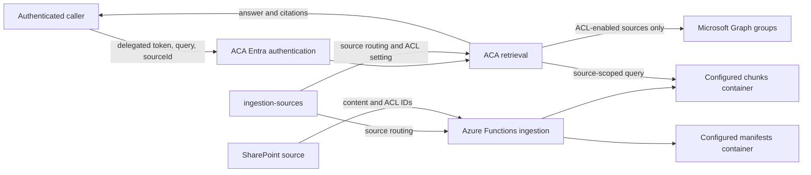
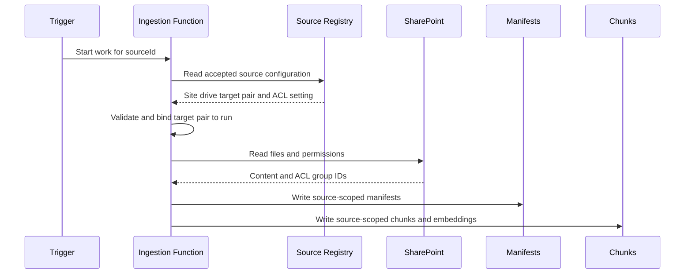
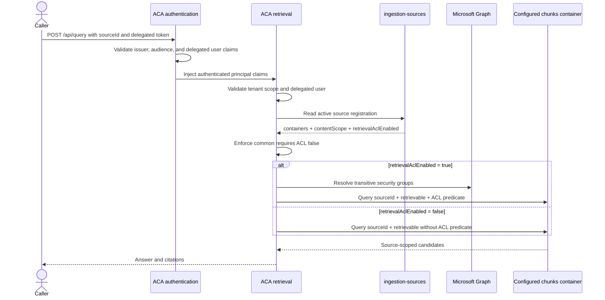

# Business Container Routing Requirement and Design

## Status and boundary

This document records the approved requirement and implemented design.
Release readiness and remaining production gates are maintained in
[Production Readiness](PRODUCTION_READINESS.md).

- Requirement status: approved.
- Design status: implemented, fresh-content cut over, and validated through
  deployed and local source-aware retrieval.
- Existing SharePoint sites and compatible Azure resources are reused.
- Azure Functions owns ingestion only.
- For this milestone, the required retrieval path is direct ACA access from a
  local Postman/PowerShell/client environment to the ACA FQDN. No Function query
  gateway is introduced.
- The former internal ACA environment was replaced by an external-access,
  VNet-integrated environment rather than adding a parallel query gateway.
- Production SKU approval remains measurement-gated; it does not block
  functional implementation or development load testing.
- Application and Bicep implementation are complete for this contract.

## Why the change is required

Before this change, the source registry gave each SharePoint drive a stable
`sourceId`, but its configuration contained only the SharePoint site and drive
binding. Ingestion container names came from application settings. Retrieval
accepted no `sourceId` and searched every configured Cosmos retriever.

The required behavior is different:

1. Each source must identify its pre-created chunks and manifests containers.
2. Ingestion and retrieval must use the same configured container pair.
3. Retrieval must address exactly one requested source.
4. Every source must retain ingested ACL metadata. Retrieval applies or skips
   the ACL predicate from that source's latest accepted
   `retrievalAclEnabled` value.
5. A file with at least one verified Entra security-group grant must not be
   rejected because it also has a sharing link, direct-user grant, unsupported
   principal type, or another non-authorizing permission observation.

## Repository evidence

| Current contract | Evidence | Required design response |
| --- | --- | --- |
| Source records use an exact schema-v1 config with source binding, container routing, and ACL policy but no business label | [`app/source_registry.py`](../app/source_registry.py) | Add required `businessName` in place and recreate dev registrations |
| Durable source plans carry the full source record, catalog ETag, and immutable binding digest | [`app/ingestion/source_registry.py`](../app/ingestion/source_registry.py) | Carry the accepted label snapshot but exclude it from ingestion work-validity comparisons |
| Ingestion repositories are cached by resolved container pair | [`app/function_app.py`](../app/function_app.py) and [`app/ingestion/repository.py`](../app/ingestion/repository.py) | Preserve pair isolation while adding metadata to source-document records |
| Query requests require one `sourceId` at the ACA boundary | [`app/retrieval/main.py`](../app/retrieval/main.py) | Add the accepted business label to the selected-source snapshot only |
| Retrieval point-reads one source and resolves one registered pair | [`app/retrieval/source_policy.py`](../app/retrieval/source_policy.py) and [`app/retrieval/cosmos_registry.py`](../app/retrieval/cosmos_registry.py) | Preserve one-source routing and carry the label only as request/audit context |
| ACL behavior and Graph resolution use the selected source policy | [`app/retrieval/service.py`](../app/retrieval/service.py) and [`app/retrieval/cosmos.py`](../app/retrieval/cosmos.py) | Keep `businessName` outside ACL policy and authorization |
| Retrieval revalidates complete ETag-bearing source eligibility | [`app/retrieval/source_policy.py`](../app/retrieval/source_policy.py) | Revalidate the lifecycle/routing/ACL projection while allowing a label-only ETag change |
| ACA validates delegated users directly and the Function query boundary is absent | [`infra/modules/aca.bicep`](../infra/modules/aca.bicep), [`app/retrieval/auth.py`](../app/retrieval/auth.py), and [`app/function_app.py`](../app/function_app.py) | Preserve the deployed authentication boundary |
| Retrieval runs in an external-access, VNet-integrated ACA environment | [`infra/modules/external-aca-environment.bicep`](../infra/modules/external-aca-environment.bicep) | Preserve public ingress and private downstream access |
| Six source-specific content containers and scoped workload assignments are provisioned | [`infra/modules/cosmos-content-topology.bicep`](../infra/modules/cosmos-content-topology.bicep) and [`infra/modules/cosmos-content-rbac.bicep`](../infra/modules/cosmos-content-rbac.bicep) | Add no infrastructure or RBAC change for metadata |
| Source purge is source-filtered, audited, and coordinator-protected | [`app/function_app.py`](../app/function_app.py) | Reuse that safety boundary during fresh-content cutover |
| SharePoint ACL admission already collects verified groups and structured non-authorizing feedback | [`app/ingestion/graph.py`](../app/ingestion/graph.py) | Preserve the completed ACL contract |

## Confirmed decisions

| Decision | Approved value |
| --- | --- |
| Cosmos boundary | Existing Cosmos DB account and database |
| Business isolation | Separate chunks and manifests containers per business |
| Shared business target | Multiple sources may use the same business container pair |
| Common target | Separate common chunks and manifests containers |
| Configuration owner | Existing `ingestion-sources` record |
| External routing key | Existing stable `sourceId` |
| Retrieval scope | One source per request |
| Shared-container query | Return only the requested `sourceId` |
| Content scope field | `contentScope` with `business` or `common` |
| Business label field | Required `businessName` for both content scopes |
| Business label behavior | ETag-protected mutable metadata; never a routing or authorization key |
| Business label history | Snapshot on content and source-context audit records; no historical rewrite |
| Retrieval ACL field | `retrievalAclEnabled` |
| Retrieval ACL values | `true` or `false` |
| Common-source invariant | `contentScope: common` requires `retrievalAclEnabled: false` |
| Source contract | Update the existing strict schema-v1 shape in place |
| Ingestion binding | Site, drive, content scope, chunks container, and manifests container |
| Mutable source metadata | `businessName` under `If-Match` |
| Mutable source policy | `retrievalAclEnabled` under `If-Match` |
| Immutable source classification | `contentScope` cannot change after registration |
| Container mapping changes | Not supported after registration in this milestone |
| Runtime routing authority | `ingestion-sources`; no environment fallback |
| Retrieval consistency | Capture one source snapshot and revalidate lifecycle/routing/ACL semantics; a label-only ETag change remains valid |
| ACA-wide ACL setting | Removed; accepted source policy is the only ACL-filter authority |
| Common ingestion | Preserve SharePoint ACL security-group IDs |
| Per-source retrieval | Apply the latest accepted `retrievalAclEnabled` value dynamically |
| Retrieval endpoint | Direct ACA `POST /api/query` |
| Retrieval authentication | ACA built-in Entra authentication with delegated-user validation |
| Direct callers | Local Postman and PowerShell users using delegated user tokens |
| Deferred external systems | Agent/OBO integration is out of scope for this milestone and tracked on hold |
| ACA environment | External-access, VNet-integrated environment; the former internal environment could not be converted |
| Provisioning | Infrastructure provisions the ACA/Cosmos resources; app validates containers and RBAC before enablement |
| Caller authorization | Retrieval API audience, tenant, delegated scope, and user claims are authoritative |
| File ACL admission | At least one independently verified Entra security-group grant |
| Mixed permissions | Non-authorizing entries produce structured feedback and do not invalidate a separate valid group grant |
| Sharing links | Record `SharedLink`; never treat link possession or scope as a retrieval grant |
| Link-only/user-only files | Reject when no verified Entra security group remains |
| ACL feedback storage | Required document-level `aclStatus`; sorted unique document-level `aclFeedback`; no duplication on chunks |
| ACL authorization hash | Continue hashing canonical `allowedGroupIds` only; feedback does not grant access |

## Functional requirements

### Source registration

The `ingestion-sources` record is the authoritative source contract. In
addition to the existing source and SharePoint binding, it must identify:

- content scope;
- business name;
- chunks container name;
- manifests container name; and
- `retrievalAclEnabled`.

Conceptual configuration:

```json
{
  "id": "business-a-site-1",
  "sourceId": "business-a-site-1",
  "schemaVersion": 1,
  "sourceKind": "sharepoint-drive",
  "desiredState": "active",
  "config": {
    "siteId": "<sharepoint-site-id>",
    "siteUrl": "https://example.sharepoint.com/sites/business-a",
    "driveId": "<sharepoint-drive-id>",
    "contentScope": "business",
    "businessName": "Business A",
    "chunksContainer": "dev-business-a-search-chunks",
    "manifestsContainer": "dev-business-a-source-documents",
    "retrievalAclEnabled": true
  }
}
```

`schemaVersion` is a source-registry contract field, not an audit field. It
tells the strict source parser which record shape to validate. Audit events
remain in the separate `service-audit` container.

The target contract does not store `recordType`. The dedicated
`ingestion-sources` container stores only ingestion-source registration
records, so repeating the same type on every item adds no routing or validation
value. Implementation must remove the current parser requirement and
`recordType` query predicates rather than introduce a compatibility fallback.

`businessName` is required, trimmed, non-empty user-facing metadata with a
maximum of 200 characters, as explicitly approved for this API contract. The
same validation applies to `business` and `common` sources; no reserved value
such as `common` is imposed or inferred. It is independent from `contentScope`,
container routing, and ACL policy. It may be updated under `If-Match` for
either content scope and is used for ownership, reporting, audit, and
operational filtering, but it does not select a physical container or grant
access.

Only `business` and `common` are valid `contentScope` values. Only Boolean
`true` and `false` are valid ACL values. A source cannot infer either value
from a container name.

Container placement and ACL behavior are separate decisions:

- `contentScope` classifies the registered source as business or common.
- `businessName` is an explicit business label captured for audit and reporting.
- `chunksContainer` and `manifestsContainer` define the physical business or
  common storage boundary.
- Sources belong to the same storage boundary only when they reference the same
  approved container pair.
- `retrievalAclEnabled` controls only whether retrieval applies the stored
  SharePoint ACL predicate.
- Neither policy field creates or selects a physical container.
- A business source may use either Boolean value.
- A common source must persist `retrievalAclEnabled: false`; `true` is invalid
  because common content is available to every authenticated retrieval user.
- Changing the Boolean does not move or re-ingest content because ACL metadata
  is retained for both values.
- Retrieval must read the latest accepted source policy for each request and
  apply the current Boolean dynamically.
- `businessName` is persisted in source registration and copied at write time to
  both `source_document` and `visual_manifest_page` records in the configured
  `source-documents` container.
- Every source-bound ingestion audit item written through
  `ingestion.telemetry.write_audit_record` copies the accepted
  `businessName` together with the stable `sourceId`.
- Retrieval query usage items and the `query_request` summary copy
  `businessName` from the request's selected-source snapshot. Global catalog
  events without a source context remain unchanged.
- Source registration writes `source_registered`; a label PATCH writes
  `source_business_name_changed` with old and new labels. Existing source-state
  and ACL-policy audit events include the accepted current label.
- `sourceId` remains the audit correlation key. `businessName` is descriptive
  snapshot context and must never replace it.
- Updating `businessName` does not rewrite existing content or audit records.
  Those records retain their historical snapshots. An already accepted
  ingestion plan keeps its captured label; plans and requests accepted after
  the update use the new value.
- `businessName` does not affect routing, ACL enforcement, source identity,
  lifecycle state, or the immutable ingestion binding digest.

The registration API may populate `retrievalAclEnabled: false` when a caller
registers `contentScope: common` without the Boolean, but the persisted source
record must always contain the explicit value. Supplying `true` for a common
source must be rejected. Business registration requires an explicit Boolean.
Missing or malformed persisted `businessName`, `contentScope`, or
`retrievalAclEnabled` configuration must fail closed; it must never disable ACL
filtering or infer a business label implicitly.

The source contract remains schema version 1 for this development reset. The
strict schema-v1 parser is updated to require the five new configuration
fields plus the existing site/drive fields and Cosmos system metadata, and to
remove `recordType`. Existing dev source registrations are deleted and
recreated before the updated runtime is enabled. There is no dual reader,
compatibility default, or record-version migration. This is an intentional
dev-only breaking change and must not be applied over retained production
schema-v1 records.

The existing operator-protected source APIs remain the management boundary:

- source registration must require `businessName`, the two container names, and
  `contentScope`, create the source as paused, validate the SharePoint binding,
  and persist an explicit valid `retrievalAclEnabled` value;
- the existing `PATCH /api/ingestion/sources/{sourceId}` contract must allow an
  ETag-protected single-field `businessName` or Boolean
  `retrievalAclEnabled` update and write the existing best-effort audit record;
- `businessName` PATCH validation must be identical for `business` and `common`
  sources and must return the accepted label and new ETag;
- that PATCH must reject `retrievalAclEnabled: true` for a common source;
- that PATCH must not accept `contentScope`, site/drive binding, or
  container-name changes; runtime reclassification and container remapping are
  outside this milestone; and
- changing only `businessName` or `retrievalAclEnabled` must not interrupt or
  reroute active ingestion.

If a future requirement needs to move an existing source to another pair, it
requires a separately approved paused-source cutover with purge, control-state
reset, and fresh ingestion. No such remapping behavior is implemented in this
milestone.

To keep ingestion and retrieval changes independent, the updated schema-v1
contract has three different consistency boundaries:

- source registration and label PATCH use Cosmos `If-Match`; the item ETag
  remains the optimistic-concurrency authority for writes;
- ingestion work validity compares the expected lifecycle state and immutable
  binding digest. The digest covers `sourceId`, tenant, site, drive,
  `contentScope`, chunks container, and manifests container, but excludes
  `businessName` and `retrievalAclEnabled`; label or retrieval-policy changes
  therefore do not invalidate already accepted ingestion work; and
- retrieval captures `businessName` with the selected source, then revalidates
  the source's lifecycle, `contentScope`, container pair, and
  `retrievalAclEnabled` before returning an answer. The catalog ETag is retained
  as audit evidence but is not itself the validity comparison because a
  label-only update changes that ETag without changing retrieval semantics.

Therefore, a Boolean policy update affects subsequent retrieval requests but
does not invalidate an in-flight ingestion plan. A label-only change also
leaves in-flight ingestion and retrieval valid; those operations retain their
accepted label snapshot. If lifecycle, routing, or ACL semantics change during
a retrieval request, that request must fail closed and may be retried against
the new source snapshot.

The ACA-wide `ACL_ENABLED` setting has been removed. The accepted source
snapshot's `retrievalAclEnabled` value is the only ACL-filter policy authority;
there is no independent deployment-wide override.

### Ingestion

Azure Functions remains the ingestion owner. For each `sourceId`, ingestion
must:

1. Load and validate the accepted source registration before starting source
   work.
2. Resolve its chunks and manifests containers in the existing database.
3. Verify that both configured containers exist and match the required schema,
   partition key, vector policy, and full-text policy.
4. Bind the source run to the validated target pair so every child activity
   uses the same immutable routing decision.
5. Discover and download content from only the registered SharePoint
   site/drive.
6. Extract, chunk, enrich, and embed using the existing pipeline.
7. Ingest `allowedGroupIds` using the existing SharePoint ACL resolution for
   sources with either value of `retrievalAclEnabled`.
8. Persist document-level ACL status and structured feedback independently of
   chunk authorization metadata.
9. Write manifests only to the configured manifests container and chunks only
   to the configured chunks container.
10. Preserve `sourceId` on manifests, chunks, lifecycle records, and citations.
11. Route delta changes, ACL refreshes, deletions, lifecycle reconciliation,
    retries, and source retirement through the same configured target pair.
12. Preserve independent source checkpoints, retries, run outcomes, pause, and
    retirement behavior.

#### Read-only provisioning preflight

Before cutover, `POST /api/ingestion/sources/preflight` accepts the same strict
body as registration but persists nothing. It confirms the Graph site/drive
relationship, exact content-container partition/index policies, and actual
Function metadata/query access. Registration and preflight share one parser so
their accepted request shapes cannot drift.

The Function must not impersonate the retrieval managed identity or issue a
probe write merely to test authorization. Function write and retrieval read
permissions remain deployment-owned checks: the content-RBAC module assigns
Built-in Data Contributor and Built-in Data Reader at each container scope,
and the deployment gate validates those assignments. `preflightPassed` means
the route-owned checks passed; it is not permission to activate or cut over a
source.

#### File ACL admission and feedback

ACL evaluation must collect evidence from the complete Graph permission
collection before deciding the file outcome. It must not reject a file merely
because one permission entry is non-authorizing when another entry proves a
valid Entra security-group grant.

A group grant is independently valid only when:

1. permission traversal completed successfully;
2. the permission has a supported `read`, `write`, or `owner` role;
3. the identity is an Entra group, or a SharePoint site group resolves to an
   Entra group;
4. Microsoft Graph confirms that the group exists and has
   `securityEnabled: true`; and
5. the group is not a Microsoft 365 `Unified` group.

The canonical `allowedGroupIds` set is the sorted, deduplicated set of every
group that passes those checks. The file is ACL-valid only when that set is
non-empty. This rule applies for both values of `retrievalAclEnabled`; that
source policy changes retrieval filtering, not ingestion admission.

Each document must carry:

```json
{
  "aclStatus": "Verified",
  "aclFeedback": ["DirectUser", "SharedLink"],
  "allowedGroupIds": ["<verified-security-group-id>"],
  "aclHash": "<group-authorization-hash>"
}
```

- `aclStatus` is `Pending` before successful evaluation and `Verified` only
  when `allowedGroupIds` is non-empty.
- `aclFeedback` is a sorted, unique array whose allowed values are
  `DirectUser`, `InvalidGroup`, `InvalidIdentity`, `SharedLink`, `SiteGroup`,
  `UnifiedGroup`, and `UnsupportedRole`.
- A verified group-only file has `aclFeedback: []`.
- Feedback is document-level diagnostic metadata. Chunks retain only
  `allowedGroupIds`, because feedback does not participate in authorization.
- Sharing URLs, link tokens, email addresses, display names, and other
  sensitive permission payloads must not be persisted or logged.
- `aclHash` continues to represent canonical `allowedGroupIds` and the ACL
  policy version only. Feedback changes must be detected and persisted
  separately so they do not cause unnecessary chunk authorization rewrites.

Permission handling must follow this decision matrix:

| Permission evidence | Admission | Feedback | Retrieval authority |
| --- | --- | --- | --- |
| One or more verified security groups only | Accept | Empty | Verified groups |
| Verified group plus any sharing link | Accept | `SharedLink` | Verified groups only |
| Specific-people link containing a verified group | Accept | `SharedLink` | Verified groups only |
| Direct user plus verified group | Accept | `DirectUser` | Verified groups only |
| SharePoint site group resolving to a verified group | Accept | `SiteGroup` | Resolved verified groups |
| Unified, disabled, deleted, or malformed group plus a verified group | Accept | Corresponding observation | Remaining verified groups |
| Unsupported role plus a separate supported group grant | Accept | `UnsupportedRole` | Supported verified groups |
| Sharing link, direct users, Unified groups, or invalid groups only | Reject | Safe terminal reason | None |
| Incomplete paging, invalid top-level response, throttling, or dependency failure | Retry/fail closed | Dependency error | None |

The presence of an anonymous or organization sharing link must never make the
document tenant-wide in RAG. A caller still needs membership in one of the
stored `allowedGroupIds` when `retrievalAclEnabled` is `true`. A direct user or
link recipient who is not in a stored group is not authorized by this
milestone.

The initial and final ACL reads during document processing must compare the
full verified result, including feedback, before publication. Winner reuse
must compare both group authorization and feedback. ACL resync must:

- update chunks and authorization metadata when `allowedGroupIds` changes;
- update only document feedback when groups are unchanged;
- make the document non-retrievable and retire it as `acl_revoked` when no
  verified group remains; and
- restore a previously ACL-revoked document only after a verified group grant
  returns and the existing source-version guards pass.

The schema-v1 `SourcePlan` passed to Durable activities must contain both
container names and the ingestion binding digest. `config_for_source` must bind
those names into the per-source runtime configuration. Repository and lifecycle
client caches must be keyed by the resolved container pair rather than by one
global repository, so sources sharing a business pair reuse the same clients
without crossing source boundaries.

An unavailable or invalid mapping must fail explicitly for that source.
Ingestion must not fall back to another business pair, the common pair, or the
legacy default pair.

The shared `ingestion-runs` container continues to own source-scoped
coordination and checkpoints. Business content and manifests reside only in
the configured business/common target pair. A failure in one source or target
must not block unrelated sources.

### Final source-to-container mapping contract

The source registry owns routing. Clients select a logical source and never
select physical storage.

| Contract element | Final decision |
| --- | --- |
| Caller routing input | Required `sourceId` only |
| Routing authority | Schema-v1 `ingestion-sources` item whose `id`, partition key, and `sourceId` are equal |
| Physical target | The registered `chunksContainer` and `manifestsContainer` pair |
| Immutable binding | Tenant/site/drive, `contentScope`, and both container names |
| Mutable non-routing metadata | `businessName` |
| Mutable retrieval policy | `retrievalAclEnabled`, subject to `common` requiring `false` |
| Shared pair behavior | Multiple sources may share a pair, but every query still filters by the requested `sourceId` |
| Eligibility | Only an active, strict, valid source registration is eligible |
| Lookup | One point read by `sourceId`; no registry enumeration |
| Fallback | None: no default, common, legacy, or alternate-pair fallback |
| Consistency fence | Re-read lifecycle, scope, pair, and ACL policy before releasing evidence |

This keeps the public API independent from Cosmos topology. Renaming or moving
containers does not create a second client contract; an approved source
re-registration and fresh cutover would be required instead. It also prevents
a caller from bypassing source policy by supplying a container name.

### Direct ACA retrieval API

The external contract is ACA `POST /api/query`. Azure Functions does
not expose or proxy a query endpoint. Local Postman, PowerShell, and
command-line clients call the ACA FQDN directly with a delegated user token.

The former managed environment had `internal: true`. Microsoft documents that
an internal environment has no public endpoint and its accessibility level
cannot change after creation. The existing retrieval Container App therefore
cannot become directly internet-accessible in place even though its app
ingress already has `external: true`.

This requirement did not require a new logical gateway or an extra Function
query endpoint. The goal was simply: from a local client, call the ACA
retrieval endpoint directly and get a response. The development cutover
therefore replaced the internal ACA environment with an external-access
environment; no Function proxy was added.

Options evaluated:

| Option | Result | Decision |
| --- | --- | --- |
| Keep the internal environment and use VPN/private connectivity | ACA remains direct, but an ordinary local Postman/PowerShell client has no route without additional private connectivity | Rejected for the stated local-access goal |
| Recreate ACA in an external-access, VNet-integrated environment | ACA receives a public FQDN while retaining private dependency access | Selected |
| Add Function, API Management, Front Door, or another reverse proxy | Provides public ingress but adds a query gateway | Rejected because ACA must be the endpoint |

The selected development design was a clean replacement: delete the retrieval
Container App and internal managed environment, wait until Azure releases the
dedicated infrastructure subnet, create an external-access environment with
`internal: false` on that same subnet, and redeploy the retrieval image, UAMI,
Cosmos/OpenAI/Graph permissions, configuration, and scaling settings with
external HTTPS ingress. This required development downtime. A
parallel migration would require another dedicated subnet and is not selected.
No API Management, Front Door, Function proxy, or additional query gateway is
introduced.

The request adds the required stable `sourceId` while preserving the existing
query fields.

Conceptual request:

```json
{
  "sourceId": "business-a-site-1",
  "question": "What is the retention policy?",
  "mode": "hybrid",
  "history": [],
  "top_k": 5,
  "scoring_profile": null,
  "expand_synonyms": null
}
```

`sourceId` is required at the ACA request boundary and must use the existing
source-ID validator. The request never accepts physical container names.

The response deliberately does not disclose whether a syntactically valid
source is unknown, inactive, or has no authorized evidence. Those cases return
the canonical no-evidence response with no citations. Invalid request syntax
returns `422`; unreadable or malformed policy, inaccessible selected storage,
and a routing/ACL policy change detected before evidence release return the
stable `503` dependency envelope.

The direct ACA authentication contract must:

1. Require a token issued for the retrieval API.
2. Use ACA built-in Microsoft Entra authentication to reject unauthenticated
   traffic and validate issuer/audience.
3. Validate tenant, audience, delegated user identity, `idtyp` when present,
   and the required `user_impersonation` scope in application code.
4. Derive the user object ID from the platform-injected authenticated
   principal claims.
5. Reject anonymous and application-only calls for both ACL modes.
6. Generate a request/correlation identifier in ACA.

This is a simplified, direct-user design. Agent-specific client IDs,
client allowlists, and OAuth OBO integration are deferred to a separate,
explicitly approved follow-up. They are intentionally out of scope for this
milestone and tracked in the on-hold follow-up list. Therefore Agent 1 and
Agent 2 do not yet have an approved application-authentication contract for
this endpoint; they must not reuse a user token or construct Easy Auth headers.

Postman, PowerShell, and command-line tests use a delegated user access token
for `api://<retrieval-api-client-id>/user_impersonation` acquired from a
native/public dev client. They send only the bearer token and request body to
`https://<aca-fqdn>/api/query`; they must not construct `X-MS-CLIENT-PRINCIPAL`,
gateway context, or gateway request-ID headers.

Provisioning and RBAC validation ownership are split intentionally:

- Infrastructure/platform ownership creates and updates the ACA, Cosmos
  resources, identity assignments, and network configuration.
- Application ownership validates that every configured source has a valid
  container pair, a matching source registration, and the required Cosmos
  data-plane RBAC before enabling the source for retrieval.
- The app does not assume provisioning is complete or that a target container
  set is already valid; mismatches fail closed for that source.

The implementation surfaces are explicit:

- `aca-environment.bicep`: recreate the environment with
  `vnetConfiguration.internal: false`;
- `aca.bicep`: retain `external: true`, set `allowInsecure: false`, keep
  `Return401`, retain the retrieval API audience, remove any gateway-specific
  application/principal allowlist, and output the public HTTPS retrieval URL;
- `main.bicep`: stop deploying the private ACA DNS zone because the external
  environment uses the platform public FQDN; retain private DNS for downstream
  private endpoints;
- `retrieval-config.bicep` and retrieval settings: remove Function gateway
  client/principal settings;
- retrieval authentication code: validate the ACA-injected delegated user
  principal directly, generate the request ID, and remove the required custom
  gateway headers;
- `function_app.py` and Function settings: remove `/api/query`,
  `RETRIEVAL_SERVICE_URL`, `RETRIEVAL_SERVICE_SCOPE`, and Function retrieval
  service-token acquisition; and
- Entra prerequisites: retain the retrieval API registration and
  `user_impersonation` scope and register/approve the native client used by
  Postman/PowerShell; do not add agent-specific app registrations in this
  milestone. Remove the Function UAMI's retrieval-gateway app-role assignment
  after cutover.

For each request, the retrieval path must:

1. Authenticate and authorize the delegated caller at the ACA boundary.
2. Generate the request ID.
3. Validate `sourceId`.
4. Point-read one accepted, active schema-v1 source registration.
5. Capture its ETag, `businessName`, target pair, `contentScope`, and
   `retrievalAclEnabled` value, and enforce the common-source invariant.
6. Resolve one retriever keyed by that unique chunks/manifests pair.
7. Resolve transitive user groups only when `retrievalAclEnabled` is `true`.
8. Query only that retriever and always filter by the requested `sourceId`.
9. Apply the access-mode behavior below per request rather than at retriever
   construction time.
10. Re-read the source and require the same active state, `contentScope`,
    target pair, and ACL policy before releasing the answer and citations.
    Retain the captured ETag for audit, but allow a label-only ETag change.
11. Preserve lifecycle revalidation, citations, audit records, and explicit
   dependency errors.

These steps remain the required retrieval behavior for a locally authenticated
PowerShell/Postman user or another delegated-user client. The direct ACA
endpoint is the contract boundary; the Function app is not used as a query
gateway for this milestone.

The request must not fan out across unrelated container pairs.

The source registry replaces `COSMOS_REGISTRY_JSON` and the fixed
chunks/manifests environment variables as routing authorities after cutover.
The ACA process may cache Cosmos container clients by unique container pair,
but it must read the requested source policy for every query. A cached
retriever must not cache `retrievalAclEnabled`; the ACL predicate is a
per-request argument.

ACA delegated-principal validation must be separated from Graph group
resolution. Tenant, audience, delegated user, and required scope are always
validated. Graph is called only after the requested source policy is captured
and only when its Boolean is `true`.

### Retrieval access behavior

| `contentScope` | `retrievalAclEnabled` | Valid | Resolve user groups | Apply ACL query predicate | Source/lifecycle filter |
| --- | --- | --- | --- | --- | --- |
| `business` | `true` | Yes | Yes | Yes | Yes |
| `business` | `false` | Yes | No for authorization | No | Yes |
| `common` | `false` | Yes | No for authorization | No | Yes |
| `common` | `true` | No | N/A | N/A | N/A |

`retrievalAclEnabled: false` means every user accepted by the existing query
authentication flow can retrieve that source's eligible content. It is
mandatory for common sources and explicitly configurable for business sources.
It does not mean anonymous access. Source filtering, active-source policy,
retrievability, and citation revalidation remain mandatory.

Changing a business source from `true` to `false` takes effect on subsequent
retrieval requests from the latest accepted source policy. It does not require
re-ingestion because both modes retain `allowedGroupIds`. Changing it back to
`true` restores group resolution and the ACL predicate on subsequent requests.
A common source cannot make this transition. Both policy fields are
security-sensitive; a missing, malformed, unknown, or invalid combination must
fail closed.

## Target system design

### Boundaries and ownership

| Boundary | Responsibility | Owned state |
| --- | --- | --- |
| Source registry | SharePoint binding, lifecycle, container mapping, retrieval ACL setting | `ingestion-sources` |
| Ingestion Function | Read SharePoint, preserve ACLs, write the registered target | Source manifests, chunks, run state |
| ACA authentication | Validate direct delegated callers before the request reaches application code | Authenticated principal headers |
| ACA retrieval | Validate delegated claims, resolve source target, retrieve one source, and enforce configured retrieval ACL setting | Client/cache state only |
| Cosmos content target | Store manifests and searchable chunks for one business/common boundary | Business/common content |
| Shared control containers | Runs, source registrations, runtime catalog, audit | Cross-source control metadata |

### Container provisioning contract

Business/common content containers are pre-created manually as required by the
approved scope. Manual creation must reproduce the existing container
contracts in `infra/modules/cosmos.bicep`:

- manifests partition key `/sourceRunId` and the current manifest indexing and
  composite-index policy;
- chunks partition key `/documentKey`, the current included/excluded paths,
  DiskANN index, 3,072-dimension cosine vector policy, and full-text policy;
- dedicated/shared throughput selected for the documented load-test baseline;
- Function UAMI Cosmos Data Contributor on both target containers; and
- retrieval UAMI Cosmos Data Reader on both target containers.

Source activation must fail until both containers exist, their data-plane
metadata matches the required contract, and both runtime identities can
perform their required operations. The application must not create, repair, or
fall back from a missing target. Microsoft documents that Cosmos SDKs require
`readMetadata` and that data-plane roles can be scoped to a container. Vector
search is not supported by retrofitting an existing non-vector container, so
the required vector policy and index must be present when each chunks
container is created.

### Target flow



### Ingestion routing sequence



### Source-aware retrieval sequence



### Failure boundaries

- Unknown, paused, retired, or malformed source: reject explicitly.
- Missing target containers: dependency/configuration failure; no fallback.
- ACL-enabled group resolution failure: fail closed.
- ACL-disabled source: group resolution is not an authorization dependency.
- One source ingestion failure must not block unrelated sources.
- A source cannot query documents belonging to another source even when both
  use the same physical container pair.

### Fresh-content cutover

Cutover is source-scoped because the current control container holds delta
cursors, run pointers, triggers, and recovery authorities for each source.
Deleting only manifests/chunks while retaining those old operational pointers
could allow post-cutover delta work to assume a corpus that no longer exists.

For each source:

1. Inventory its approved `contentScope`, business/common target pair, and
   initial Boolean policy.
2. Pre-create the target containers, assign both UAMIs, and validate the
   provisioning contract.
3. Quiesce the source through the existing drive-coordinator maintenance
   boundary so full, delta, ACL, lifecycle, and webhook work cannot race
   cutover.
4. Delete that source's existing manifests and chunks from the legacy content
   containers using the existing source-filtered, audited purge behavior.
5. Remove or reset source-scoped operational records that reference the old
   corpus, including run pointers, delta cursor, trigger/work records, and
   recovery state. Preserve the source identity, SharePoint binding, runtime
   catalog, and service-audit history.
6. Recreate the source registration with the updated strict schema-v1 fields,
   rebuild its accepted serving/binding state, and mark a fresh full sync as
   required.
7. Run the guarded fresh full ingestion into the configured target pair; do
   not migrate or reuse previously indexed content.
8. Validate ingestion completeness, target/source isolation, ACL metadata,
   both retrieval policy values, citations, and no legacy content before
   activating recurring ingestion and retrieval.

Global `ACL_ENABLED`, `COSMOS_REGISTRY_JSON`, and fixed content-container
routing are removed before cutover. There is no legacy runtime fallback.

Existing SharePoint sites and non-ACA dependencies are reused. The ACA managed
environment and Container App are deliberately recreated because Microsoft
does not support changing an environment from internal to external after
creation.

## Existing resource reuse assessment

| Existing asset | Reuse decision | Evidence boundary |
| --- | --- | --- |
| SharePoint sites and drives | Reuse | The change adds source routing; it does not require a SharePoint migration. Each drive keeps its stable `sourceId`. |
| Cosmos DB account and database | Reuse | The approved boundary adds business/common container pairs in the existing database. Exact production throughput remains unapproved until measured. |
| `ingestion-sources`, `ingestion-runs`, `retrieval-config`, `service-audit` | Reuse as shared control containers | They own source/configuration/operations state rather than one business content corpus. |
| Function App | Reuse for ingestion only | Remove the query route, retrieval-service token acquisition, and retrieval gateway settings. |
| ACA retrieval image and UAMI | Reuse for direct retrieval | Keep Cosmos, OpenAI, Graph, ACR, and monitoring permissions; replace gateway-header authentication in application code. |
| Former internal ACA managed environment | Recreated as external-access | Environment accessibility cannot change in place. The development ACA app and environment were recreated with `internal: false`, reusing the existing VNet infrastructure subnet after the old environment released it. |
| ACA retrieval Container App | Recreate in the external-access environment | Keep HTTPS external ingress and ACA authentication; expose its FQDN as the retrieval endpoint. |
| Storage and Durable Task Scheduler | Reuse | The target design does not change their ownership; capacity requires measured orchestration demand. |
| Document Intelligence and Azure AI Language | Reuse | The routing requirement does not change extraction/enrichment providers; service quota must be validated against measured ingestion demand. |
| Speech and Content Understanding | Reuse only when their existing optional paths are selected | General SharePoint volume does not establish that either optional path is required. |
| Azure OpenAI deployments | Reuse subject to quota validation | Model calls remain part of embedding/planning/generation; exact TPM/RPM is unknown. |
| Key Vault and managed identities | Reuse | Existing certificate and service-to-service identity boundaries remain unchanged. |
| VNet and downstream private endpoints/DNS | Reuse | The external ACA environment remains VNet-integrated for private dependency access. Only the obsolete private DNS zone that mapped the former internal ACA environment domain was removed. |

No evidence currently justifies replacing an existing SharePoint site or Azure
resource solely for business-container routing.

## Development container topology

The minimum dev topology that covers the approved scenarios has six content
containers and four shared control containers.

### Content containers

| Container | Sources | Purpose |
| --- | --- | --- |
| `dev-business-a-search-chunks` | Business A source 1 and source 2 | Prove multiple sources can share one target and remain source-isolated |
| `dev-business-a-source-documents` | Business A source 1 and source 2 | Business A manifests and lifecycle evidence |
| `dev-business-b-search-chunks` | Business B source 1 | Prove cross-business target isolation |
| `dev-business-b-source-documents` | Business B source 1 | Business B manifests and lifecycle evidence |
| `dev-common-search-chunks` | Common source 1 | Prove ACL metadata is retained but retrieval skips ACL filtering |
| `dev-common-source-documents` | Common source 1 | Common manifests and lifecycle evidence |

### Shared control containers

- `ingestion-sources`;
- `ingestion-runs`;
- `retrieval-config`; and
- `service-audit`.

### Minimum source matrix

| Source | `contentScope` | Target | ACL mode | Scenario |
| --- | --- | --- | --- | --- |
| `dev-business-a-1` | `business` | Business A pair | `true`, then `false`, then `true` | Verify policy changes affect subsequent retrieval without re-ingestion |
| `dev-business-a-2` | `business` | Business A pair | `true` | Shared target with strict `sourceId` isolation |
| `dev-business-b-1` | `business` | Business B pair | `true` | Cross-business container isolation |
| `dev-common-1` | `common` | Common pair | `false` only | Same result for authenticated ACL member and non-member |

Invalid container names, missing configuration, unknown sources, paused
sources, and target unavailability can be tested through configuration and
state changes; they do not require additional containers.

## Production sizing evidence boundary

The supplied production input establishes only a minimum raw corpus:

```text
40-70 sites per business x at least 1 GB per site
= at least 40-70 GB per business
```

It does not determine production capacity. Raw bytes do not determine file
count, pages, extracted tokens, chunk count, vector/index expansion, Cosmos
request units, ingestion concurrency, AI-service request rate, retrieval QPS,
OpenAI tokens, telemetry volume, or availability topology.

Exact production capacity remains blocked on measured workload inputs listed
in [Azure resource inventory](AZURE_RESOURCES.md#production-sizing-decision).

### Approximate performance-test baseline

The following is an initial load-test configuration for the stated minimum
40-70 GB raw corpus per business. It is not a production guarantee or cost
approval. Increase or reduce it only from measured throttling, utilization,
latency, and quota evidence.

| Resource | Initial baseline | Validation trigger |
| --- | --- | --- |
| Cosmos chunks container per business | Provisioned autoscale, 10,000 RU/s maximum | Capacity Planner plus measured ingest and hybrid-query RU, 429 rate, latency, index size, and hot partitions |
| Cosmos manifests container per business | Provisioned autoscale, 4,000 RU/s maximum | Measured create/update/delete RU, lifecycle query rate, and storage |
| Shared Cosmos control containers | Database shared autoscale, 4,000 RU/s maximum | Run/source/audit operation rate and throttling |
| Function App | Flex Consumption, 2,048 MB, maximum 40 instances | Per-activity memory/CPU, concurrent files, completion window, Graph and AI-service throttling |
| Retrieval ACA | 1 vCPU/2 GiB, minimum 2 and maximum 10 replicas | Peak QPS/concurrency, CPU/memory, p95/p99 latency, dependency saturation |
| Durable Task Scheduler | Consumption | Orchestration starts, work items, retries, and scheduling latency |
| Document Intelligence | S0 | Pages/minute, concurrent analyses, file/page limits, and regional quota |
| Azure AI Language | S | Characters/records per minute and enabled feature mix |
| Azure AI Speech | S0 only when audio is enabled | Audio hours, concurrent jobs, and turnaround target |
| Content Understanding | AIServices S0 only when selected | Pages/minute and underlying model token demand |
| Storage | Standard ZRS | Availability objective, transaction metrics, and RPO/RTO |
| ACR | Basic unless private ACR access is required; Premium when Private Link is required | Image pull/push demand and private-access requirement |
| Azure OpenAI | Keep existing deployments for the first test; do not set a numeric production capacity yet | Measured embedding and chat TPM/RPM, tokens/query, latency, and quota headroom |
| Monitoring | Pay-as-you-go workspace, 90-day test retention, no restrictive daily cap during measurement | Measured GB/day, compliance retention, and cost ceiling |

These numbers are deliberately benchmark starting points. The production
decision remains open until the measurements listed above are captured.

## Acceptance criteria

1. Every active source has one valid `contentScope`, chunks/manifests mapping,
   and Boolean ACL setting; common sources always persist `false`.
2. Multiple sources can share a pair without cross-source retrieval.
3. Ingestion writes ACL metadata for both modes.
4. `retrievalAclEnabled: true` is accepted only for business sources and
   returns only documents allowed by SharePoint group ACLs.
5. `retrievalAclEnabled: false` returns that source's eligible content to
   authenticated members and non-members without applying the ACL predicate.
6. Content remains inaccessible anonymously for either Boolean value.
7. External callers pass `sourceId`, not physical container names.
8. ACA queries only the configured target pair and requested source.
9. Missing or invalid configuration, including `contentScope: common` with
   `retrievalAclEnabled: true`, fails explicitly without fallback.
10. Existing SharePoint sites, source lifecycle, citations, and audit behavior
    remain intact.
11. After cutover, no ACA-wide ACL toggle remains; ACL behavior is determined
    only by the validated source registration.
12. Local authenticated callers can call the public ACA retrieval endpoint with
    a delegated user token.
13. Azure Functions has no query route, retrieval proxy settings, retrieval
    service-token acquisition, or ACA gateway role.
14. Changing a business source's `retrievalAclEnabled` value takes effect from
    the latest accepted source policy on subsequent requests without
    re-ingestion.
15. Cutover deletes existing indexed manifests and chunks and performs a fresh
    full ingestion; previously indexed content is not migrated or reused.
16. Every recreated source uses the updated strict schema-v1 contract; no
    schema-v2 or compatibility reader exists.
17. A policy change during retrieval fails closed; retry uses the latest
    accepted valid scope/Boolean combination.
18. Updating only `retrievalAclEnabled` does not interrupt or reroute active
    ingestion.
19. Manual target provisioning validates partition/index/vector/full-text
    policies and both required Cosmos data-plane role assignments.
20. Provisioning and app validation are explicitly owned by separate teams or
    responsibilities, and the app refuses to activate a source until both are
    confirmed.
21. Cutover resets source-scoped pointers and delta/work state that reference
    the deleted corpus while preserving source identity and audit history.
22. The ACA FQDN resolves publicly and an authenticated local client reaches
    `/api/query` without traversing Azure Functions.
23. A file with a verified Entra security-group grant ingests successfully
    when another permission is a sharing link, direct user, Unified group,
    invalid group, unsupported role, or malformed entry.
24. Sharing links and other feedback never add retrieval principals; chunks
    remain authorized only by verified `allowedGroupIds`.
25. A file with no verified Entra security group is rejected even when it has
    a sharing link or direct-user permission.
26. Incomplete Graph permission traversal and dependency failures do not
    become `NoSecurityGroup`; they retry or fail closed explicitly.
27. ACL feedback changes persist without rewriting chunk authorization when
    `allowedGroupIds` is unchanged.
28. ACL resync retires a document when its last verified group disappears and
    restores it only after a verified group returns.
29. Every recreated source registration contains one trimmed, non-empty
    `businessName` of at most 200 characters; valid labels are accepted
    identically for `business` and `common` scopes without a reserved `common`
    value.
30. `businessName` can be changed under `If-Match` for either content scope;
    stale ETags and attempts to combine the rename with immutable binding
    changes fail explicitly.
31. A label change does not alter the source binding digest, selected container
    pair, ACL policy, lifecycle state, or retrievability.
32. Every newly written `source_document` and `visual_manifest_page` record
    contains the accepted `businessName` snapshot.
33. Source registration/rename events, every source-bound ingestion audit
    item, retrieval query usage item, and `query_request` summary contain both
    stable `sourceId` and accepted-context `businessName`; authorization and
    correlation never depend on the label.
34. Renaming a source does not rewrite historical content or audit snapshots;
    already accepted ingestion plans keep their captured label, while plans
    and requests accepted after the update use the new label.

## Implementation validation matrix

The implementation is not complete until targeted tests prove:

- updated strict schema-v1 parsing, rejection of the old v1 shape, and no
  routing fallback;
- required `businessName` validation for both content scopes, ETag-protected
  rename behavior, unchanged binding digest, and write-time content/audit
  snapshots;
- `contentScope` accepts only `business` or `common`; common registration
  persists `false`, rejects `true`, and missing persisted policy fails closed;
- registration and ETag-protected Boolean policy updates through the existing
  operator boundary;
- immutable SourcePlan routing for full sync, delta, ACL refresh, deletion,
  reconciliation, retry, retirement, and fresh-ingestion cutover;
- two sources sharing one pair remain isolated by `sourceId`;
- two business pairs cannot cross-read or cross-write;
- `true` resolves groups and applies the ACL predicate;
- `false` skips Graph group resolution and the ACL predicate but retains
  authentication, source, lifecycle, and retrievability filters;
- mixed SharePoint permissions are collected before admission; a verified
  group plus a sharing link or other observation succeeds;
- link-only, user-only, Unified-only, deleted-only, and disabled-only
  permissions fail because no verified group remains;
- direct users, sharing links, Unified groups, invalid groups, malformed
  identities, and unsupported roles never become retrieval principals;
- `aclStatus` and sorted unique `aclFeedback` persist on documents but not
  chunks, and no sensitive sharing-link values are stored or logged;
- feedback-only ACL changes update document metadata without toggling chunk
  retrievability;
- incomplete paging, malformed permission collections, throttling, and Graph
  failures remain explicit retry/fail-closed outcomes;
- business-source `true` to `false` to `true` changes apply without
  re-ingestion;
- a source ETag change during retrieval fails closed before response;
- missing containers, policy mismatch, and RBAC denial fail explicitly;
- ACA rejects anonymous, app-only, wrong-tenant, wrong-audience,
  wrong-client, and missing-scope calls;
- a delegated-user caller can call ACA directly from Postman and PowerShell;
- agent/OBO access is intentionally deferred and tracked as on-hold work;
- the Function query route and all Function-to-ACA gateway configuration are
  absent;
- the external-access ACA endpoint remains able to reach Cosmos, OpenAI,
  Microsoft Graph, ACR, monitoring, and other required private dependencies;
  and
- source-scoped cutover removes old content and stale operational pointers,
  then completes a fresh full ingestion before activation.

## Microsoft guidance

- [Azure Cosmos DB resource model](https://learn.microsoft.com/azure/cosmos-db/resource-model)
- [Request units in Azure Cosmos DB](https://learn.microsoft.com/azure/cosmos-db/request-units)
- [Cosmos DB data-plane security](https://learn.microsoft.com/azure/cosmos-db/reference-data-plane-security)
- [Index and query vector data in Python](https://learn.microsoft.com/azure/cosmos-db/how-to-python-vector-index-query)
- [Cosmos DB service quotas and limits](https://learn.microsoft.com/azure/cosmos-db/concepts-limits)
- [Web API design best practices](https://learn.microsoft.com/azure/architecture/best-practices/api-design)
- [Azure Architecture Center: Design for change](https://learn.microsoft.com/azure/architecture/guide/design-principles/design-for-evolution)
- [Azure Architecture Center: Minimize coordination](https://learn.microsoft.com/azure/architecture/guide/design-principles/minimize-coordination)
- [Authentication and authorization in Azure Container Apps](https://learn.microsoft.com/azure/container-apps/authentication)
- [Enable Microsoft Entra authentication in Container Apps](https://learn.microsoft.com/azure/container-apps/authentication-entra)
- [Container Apps ingress](https://learn.microsoft.com/azure/container-apps/ingress-overview)
- [Configure Container Apps ingress](https://learn.microsoft.com/azure/container-apps/ingress-how-to)
- [Container Apps IP restrictions](https://learn.microsoft.com/azure/container-apps/ip-restrictions)
- [Integrate an Azure Container Apps environment with a virtual network](https://learn.microsoft.com/azure/container-apps/vnet-custom)
- [Microsoft identity platform OAuth on-behalf-of flow](https://learn.microsoft.com/entra/identity-platform/v2-oauth2-on-behalf-of-flow)
- [Microsoft Graph permission resource](https://learn.microsoft.com/graph/api/resources/permission)
- [Microsoft Graph sharingLink resource](https://learn.microsoft.com/graph/api/resources/sharinglink)
- [Microsoft Graph SharePointIdentitySet resource](https://learn.microsoft.com/graph/api/resources/sharepointidentityset)
- [List effective sharing permissions on a driveItem](https://learn.microsoft.com/graph/api/driveitem-list-permissions)
