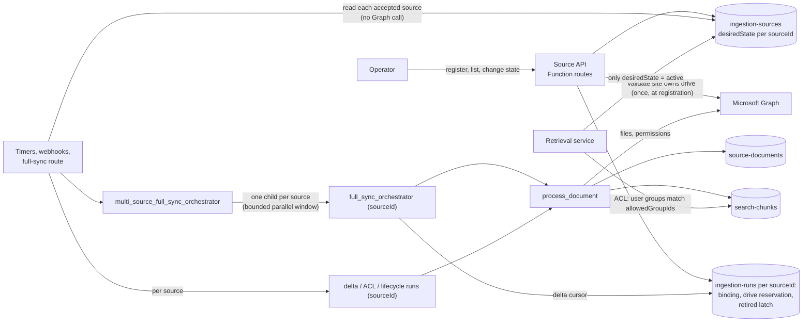

# Multi-SharePoint sources: requirements, plan, and status

This is the single, current document for the multi-SharePoint ingestion feature.
It replaces the earlier multi-source design and plan documents, which described
an expanded scope that is **not** required.

Reviewed against the current implementation and validation evidence:
2026-10-09. Update the status columns as each task completes.

**Current milestone status (2026-10-09):** Local implementation and validation
are complete. The Azure dev deployment, two source-specific full syncs, parent
multi-source dispatch, source isolation, lifecycle exclusion, retrieval modes,
audio transcript retrieval, controlled delta, four-state delegated ACL matrix,
and irreversible retirement passed. T15 is complete. The ACL matrix used one
real delegated identity with its Reader and Editor memberships changed
sequentially because the tenant had only two ordinary users; the break-glass
identity was not used.

**T17 (revised 2026-10-08):** After a retired source's writer has settled,
delete its document manifests, their visual manifest pages, and search chunks.
Preserve service-audit history using the SharePoint delta-deletion audit pattern.
Clear matching document winners; keep registration, bindings, and retirement
latch so the source cannot reactivate. Validate retries and source isolation
locally without retiring either real dev source. This supersedes content retention.

**T20 (2026-10-08):** Keep ordinary retirement terminal, but add a separate
operator-only reprovision operation for exceptional rebuilds of the same source
and immutable drive binding. Require ETag concurrency,
completed retirement, Graph revalidation, bounded operational-state cleanup,
and a new explicit full sync before the source is activated.

## Goal

Ingest and retrieve content from several SharePoint document libraries
(drives). Each drive is an isolated source with a stable `sourceId` and an
active, paused, or retired lifecycle.

**Done when** every requirement below is marked `Verified`: automated tests, a
local run against two real development drives, and the approved Azure
verification in T15.

## Requirements and status

Status values: `Gap` (not built), `Built` (code and simulated tests exist),
`Locally verified` (proven locally with real dev SharePoint data), `Verified`
(also proven in Azure by T15).

| ID | Requirement | Status | Evidence / remaining work |
|---|---|---|---|
| R1 | Configure multiple SharePoint sources and selected drives | Verified | Azure listed three stable sources; two active sources and one paused source were dispatched correctly. |
| R2 | Give each source a stable `sourceId` | Verified | Azure ingestion, manifests, chunks, and citations retained `sharepoint-drive` and `poc-pg` isolation. |
| R3 | Run full and delta ingestion independently per source/drive | Verified | Azure source-specific and parent full syncs passed with zero failed documents. A controlled `poc-pg` delta rebaseline, no-change round, one-item incremental change, audio settlement, and fixture deletion passed without changing `sharepoint-drive`. |
| R4 | Preserve the existing document schema and identity behavior | Verified | Repeated source-specific and parent Azure runs produced schema-v1 manifests and exact source-scoped chunk partitions. |
| R5 | Apply the correct source ACLs | Verified | One real delegated identity exercised Both, Reader-only, Editor-only, and Neither sequentially. Allowed sources returned citations; denied sources returned no evidence or failed closed. Both memberships were restored. |
| R6 | Prevent one source from affecting another | Verified | Source A completed before source B started; parent run created eight ready documents and eight chunks with zero cross-source rows. |
| R7 | Support active/paused/retired lifecycle | Verified | Azure pause excluded `poc-pg` citations and was reversed. The approved paused `poc-auth` source was then retired; cleanup completed, its terminal latch blocked reactivation with 409, and both active sources remained unchanged. |
| R8 | Retrieval returns only eligible content | Verified | Azure gateway passed all six standard/agentic mode cases, lifecycle exclusion, and the four-state delegated ACL matrix. |
| R9 | Verify with the agreed multi-site and document-format tests | Verified | Azure PDF and audio transcript retrieval passed, including a temporal citation, followed by the four-state ACL and controlled-delta checks. |

## Decisions

| Decision | Why | Evidence |
|---|---|---|
| Operators manage sources through a small authenticated API (register, list, change state). | Validation (the site owns the drive, no duplicate drive) happens once, when a source is written. This replaces repeated Graph checks on every trigger. Errors reach the operator immediately. This follows the Microsoft pattern for managed ingestion configuration. | [External Configuration Store pattern](https://learn.microsoft.com/azure/architecture/patterns/external-configuration-store); [Azure AI Search: create an indexer](https://learn.microsoft.com/azure/search/search-how-to-create-indexers) (portal, REST, SDK over one validated API) |
| No Azure CLI or portal-only path for source records. | Azure CLI cannot create or update Cosmos DB items. Portal Data Explorer bypasses validation. | [Cosmos DB data-plane RBAC](https://learn.microsoft.com/azure/cosmos-db/nosql/reference-data-plane-security) |
| Reuse the existing operator authorization (`Ingestion.Operator` app role via App Service authentication). | It is already used by the terminate and purge routes (`_require_ingestion_operator`). | [App Service user identities](https://learn.microsoft.com/azure/app-service/configure-authentication-user-identities) |
| State changes use ETag `If-Match`. | Prevents lost updates between concurrent operators. | [Cosmos DB optimistic concurrency](https://learn.microsoft.com/azure/cosmos-db/nosql/database-transactions-optimistic-concurrency); [Web API design](https://learn.microsoft.com/azure/architecture/best-practices/api-design) |
| One app registration for all sites. Each site needs read access for that app. | `Sites.Selected` grants per-site access to one app. | [Selected permissions overview](https://learn.microsoft.com/graph/permissions-selected-overview) |
| The source record schema does not change: `id == sourceId`, `desiredState`, `config` = {`siteId`, `siteUrl`, `driveId`}. | Preserves R4 and existing data. | `app/source_registry.py` |

## Architecture

### Before (git `HEAD`): one source from app settings

The Function App read one site and drive from required settings
(`SHAREPOINT_SITE_URL`, `SHAREPOINT_ASSIGNED_DRIVE_ID`, `INGESTION_SOURCE_ID`).
Every trigger worked on that one drive:

- One `full_sync_orchestrator`.
- One delta cursor (`delta-control`).
- One webhook subscription.
- One run pointer (`source-control`) in `ingestion-runs`.

### Now: many sources from a Cosmos registry

Retrieval reads `desiredState` only; it does not read the `source-serving`
retirement latch. Azure development Cosmos DB is the supported local retrieval
data plane.

### Implemented components

| Area | Implementation | Requirement |
|---|---|---|
| Configuration | `ingestion-sources` Cosmos container (partition `/sourceId`) and the `COSMOS_INGESTION_SOURCES_CONTAINER_NAME` setting. The single-source settings are now optional. | R1, R2 |
| Source schema | `app/source_registry.py`: `SharePointSource` (`id == sourceId`, `desiredState`, `config` = `siteId`, `siteUrl`, `driveId`). | R2, R7 |
| Source repository | `app/ingestion/source_registry.py`: catalog paging, acceptance, and per-source records in `ingestion-runs`. | R1, R6 |
| Acceptance records (per `sourceId` in `ingestion-runs`) | `source-binding` (site/drive cannot change), `drive-binding` (one source per drive), `source-serving` (retirement latch; its `retired` flag makes retirement final). | R2, R6, R7 |
| Run coordination records | `drive-coordinator`, `source-dispatch-manifest` / `source-dispatch-item`, `document-operation`, `document-winner`, delta page and round records. | R3, R6 |
| Orchestration | `multi_source_full_sync_orchestrator` starts the existing `full_sync_orchestrator` once per `sourceId`, in a bounded parallel window of `SOURCE_DISPATCH_PAGE_SIZE` children using `task_any`. Dispatch history is not compacted while children run, because continue-as-new would drop in-flight tasks; history grows with the number of sources in one dispatch. Activities cover source inventory, dispatch outcomes, document claiming, absence reconcile, delta-cursor commit, and coordinator drain and settle. | R3, R6 |
| Triggers | Timers and webhooks loop over registered sources instead of one configured drive. The loader (`_load_validated_source_plans`) and dispatch preflight read each source with `read_source_plan` (acceptance check, no Graph call); a source that fails the check is skipped alone, and an unknown webhook subscription is ignored instead of rejecting the batch (T5). | R3, R6 |
| Retrieval | `app/retrieval/source_policy.py`: serves only sources whose `desiredState` is `active`, and rechecks the source ETag for cited sources. The ACL check is unchanged. | R7, R8 |
| Shared | `app/cosmos_connection.py`: Entra-authenticated Cosmos client factory used by the Function App and retrieval (`main.py`, `cosmos_registry.py`); retrieval passes its own `DefaultAzureCredential`. | Local and Azure runs |
| Source API | State change (`PATCH /api/ingestion/sources/{sourceId}`), registration (`POST /api/ingestion/sources`), and bounded listing (`GET /api/ingestion/sources`). The one-time seed path is not part of the current implementation. | R1, R7 |

The document schema, document identity, chunk format, and ACL model are unchanged (R4).

### T13 coordination audit

| Mechanism | Decision | Requirement evidence |
|---|---|---|
| Source catalog + ETag | Keep | R1 source configuration and R7 concurrent lifecycle changes. |
| Source binding | Keep | R2 immutable source/site/drive identity. |
| Drive binding | Keep | R6 rejects duplicate-drive ownership without affecting other sources. |
| `source-serving.retired` | Keep | R7 blocks ordinary reactivation even if the catalog is edited directly; T20 can clear it only after an explicit, validated reprovision cleanup. |
| `source-serving` readiness/progress | Remove | Retrieval and triggers use catalog `desiredState`; no consumer read these fields. |
| Drive coordinator | Keep | R3 serializes one source's writers; R6 scopes failure and recovery per source. |
| Trigger instance controls | Keep | R3 prevents duplicate Durable runs for the same source trigger. |
| Dispatch manifest/items | Keep | R3 pages bounded fan-out; R6 records outcomes independently per source. |
| Document operations/winners | Keep | R3 provides idempotent document work; R6 scopes claims and winners by source. |
| Delta receipts/fragments/item state/rounds | Keep | R3 provides replay-safe paging and cursor commit per source; R6 isolates progress. |

### System design by phase

| Phase | Components changed | Contract | Data owner | Failure isolation | Status |
|---|---|---|---|---|---|
| 1. Source management (T1-T5) | Dispatch isolation; parallel child dispatch; source API routes; trigger loader. | Operator role. Codes 201, 400, 403, 404, 409, 412, 428, 422, 503. The source record schema does not change. | `desiredState` in `ingestion-sources` is the lifecycle authority. The drive reservation owns drive uniqueness. The retired flag in `source-serving` makes retirement final. | A duplicate, unaccepted, slow, or stuck source affects only itself (T1, T1b, T5). Triggers make no Graph validation call; registration validates once. | Done |
| 2. Local verification (T5a-T11a) | Local operator header; retrieval startup against Azure dev `rag-db` (T10a); fixes only for proven defects. | Same as Phase 1. | Same. | Delta, lifecycle, and ACL changes in one source leave the other unchanged (T8-T10). | Done through T11; irreversible T11a deferred by user decision |
| 3. Cleanup and docs (T12-T14) | Remove unneeded coordination code, one approved item at a time; update docs. | No change. | No change. | T6-T11a must still pass after each removal. | Done |
| 4. Azure verification (T15) | Exercise the deployed development environment after approval. | Same. | Same. | Same checks as Phase 2. | Done: full sync, dispatch, lifecycle exclusion, retrieval modes, citations, audio, controlled delta, four-state delegated ACL matrix, and retirement passed. |
| 5. Retired-source recovery (T20) | Operator-only reprovision route, bounded Durable cleanup, durable intent/receipt, and completion audit. | Same immutable source/site/drive identity; confirmation, ETag, immutable operator object ID, and Graph validation required. Result is paused; activation is blocked until an explicit bootstrap full sync succeeds. | Catalog remains lifecycle authority; source binding and drive reservation remain immutable. The source-scoped reprovision receipt owns recovery progress and attribution. | Retired latch remains fail closed through cleanup; allowlisted deletion stops on unknown records; transactional progress survives activity redelivery and ambiguous responses. | Verified locally and in live Azure; the later approved T15 test retired `poc-auth` again. |

## Plan

Work one task at a time, test first. After each task, run the narrow test, then
`tests/ingestion`, `tests/app_runtime`, `tests/retrieval`, and Ruff on changed files.

Baseline before T1 (2026-10-07, full suite): **2258 passed, 8 skipped** (the skips
are live-Cosmos integration tests).

Status values: `Not started`, `In progress`, `Done`, `Blocked`.

### Phase 1: Source management (R1, R3, R6, R7)

| ID | Task | Depends on | Acceptance | Status |
|---|---|---|---|---|
| T1 | A duplicate `driveId` fails only the offending source, not the whole dispatch or timer run. The owner is the source named in the existing drive reservation, never catalog order. If no source holds the reservation, every duplicate fails individually for operator repair. | none | Unit tests: duplicates on the same page and across pages; through full sync and one timer loader; owner A accepted before B is added. Other sources still run. Suites green. | Done |
| T1a | Add the existing `_require_ingestion_operator` check to `full-sync`, `status`, `retry-failed`, and `inspect` (approved 2026-10-07). | none | Unit tests per route: 403 without the operator role; current behavior with it. Suites green. | Done |
| T1b | Start the per-source full-sync children in parallel ([Durable fan-out/fan-in](https://learn.microsoft.com/azure/durable-task/common/durable-task-fan-in-fan-out)) instead of waiting for each one before starting the next (approved 2026-10-07). | T1 | Unit tests: source A still running or failed does not delay or block source B starting, including when A and B are on different dispatch pages (paging must not wait for earlier children); fan-out stays bounded; each outcome is recorded per source. Suites green. | Done |
| T2 | `POST /api/ingestion/sources`: operator only. Body `sourceId`, `siteUrl`, `driveId`. Validates the site and drive with Graph, then creates the source as `paused` and records acceptance. The drive reservation is the uniqueness authority. An exact retry of an interrupted registration completes it; a different source for the same drive gets 409. | T1 | Unit tests: 201; exact retry; 400 invalid input; 422 Graph validation failure; 403; 409 duplicate `sourceId` or drive; concurrent same-drive registration gives one 201 and one 409 with no usable second record; failure injected after each persisted step (catalog, binding, reservation, serving record): an exact retry completes it, and a different source for that drive gets 409; 503 on Cosmos or Graph outage. | Done: `tests/app_runtime/test_source_routes.py` (403, 400, 422 for Graph 4xx/ValueError, 503 for Graph 429/5xx/transport and Cosmos, 409, 201) and `tests/ingestion/test_source_registry.py` (exact retry, failure at each of the 4 steps, concurrent same drive). `sourceId` is checked against the Cosmos DB item-id limits (at most 1,023 bytes, no `/` or `\`; [Learn: per-item limits](https://learn.microsoft.com/azure/cosmos-db/concepts-limits#per-item-limits)). |
| T3 | `GET /api/ingestion/sources`: operator only, bounded page, returns `sourceId`, `siteUrl`, `driveId`, `desiredState`, ETag. | T2 | Unit tests: page, continuation, 403. | Done: 5 route tests (page of `SOURCE_DISPATCH_PAGE_SIZE`, continuation token, 403 x2, 503); local host confirmed GET and POST on one route reach `list_sources` and `register_source`. Lists valid sources only; an invalid continuation token returns 503. |
| T4 | `PATCH /api/ingestion/sources/{sourceId}`: operator only, requires `If-Match`. Allowed: paused↔active, active or paused→retired. Retired is final, checked against both `desiredState` and the retired flag. Step 1: replace the source record with the ETag match; this is the change retrieval and triggers use. Step 2: call `observe_lifecycle` so retirement is made final. If step 2 fails, return 503; repeating the same target state with the new ETag completes it, because the step is idempotent. Activating does not start a sync: timers or an explicit full sync do. The webhook subscription is created by the renewal timer. Pausing stops new runs; a run already in progress stops at its next step (every activity re-checks the catalog). Its drive lock is then released automatically by the next timer or webhook start, once the run has ended, no document work is open, and the lock has been unchanged for 30 minutes (`functionTimeout`). | T2 | Unit tests: each allowed change; retired→any 409; stale ETag 412; missing `If-Match` 428; unknown field or state 400; 403; 404. Failure injection: step 1 succeeds, step 2 fails → 503; retrieval already excludes a retired source; retrying the same state completes it. | Done: 11 registry tests (4 allowed changes, stale ETag and concurrent replace → `source_etag_mismatch`, retired→active/paused, retired flag with an edited catalog, unknown source, step-2 failure → `source_lifecycle_pending` with retrieval already excluding the source, then same-state retry sets the flag) and 17 route tests (200, 428, 400 x7, 403 x2, 404, 412, 409, 503 x2). Review fixes: activation first checks the binding and drive reservation, so an incomplete registration returns 409 `source_binding_not_accepted` and the catalog is unchanged. A non-string `desiredState` returns 400. A malformed `siteUrl` port or host on POST returns 400 instead of 500. |
| T5 | Triggers load sources with `read_source_plan` (acceptance check, no Graph call), isolating failures per source, including a webhook batch that mixes a known and an unknown subscription. First verify that the existing POC-Auth-Docs source in local Cosmos has its binding, reservation, and serving record. Remove the seed tool only after that check passes. | T1; T2 for seed-tool removal | Existing source verified and recorded. Timer, webhook, full-sync, terminate, and retry tests show no Graph validation calls; an unaccepted source fails alone. Identity tests (R2, R4) still pass. | Done: local Cosmos `rag-local` source `sharepoint-drive` (POC-Auth-Docs) passed `read_source_plan` (binding and reservation match) and has `source-serving` with `retired=false` (2026-10-07). All trigger paths use the loader; loader and preflight tests fail on any Graph call; tests for an unaccepted source skipped alone and a mixed known/unknown lifecycle webhook batch (200, known one renewed). Seed tool removed; the identity test now registers and activates through T2/T4. Residual: `_build_sharepoint_client` still validates the site and drive with Graph when a document is processed (outside triggers). Review fix: the loader skips only registry rejections. A transient Cosmos error now propagates, so both webhooks return 503 and Graph retries for up to 4 hours ([webhook delivery](https://learn.microsoft.com/graph/change-notifications-delivery-webhooks)). |

### Phase 2: Local two-source verification (R2-R9). Local Functions host with approved Azure development SharePoint and Cosmos DB resources.

Run in this order. POC-PG stays active until T11a, because retirement is final.

| ID | Task | Depends on | Acceptance | Status |
|---|---|---|---|---|
| T5a | Local operator header: a documented way to build the Base64 `X-MS-CLIENT-PRINCIPAL` with the `Ingestion.Operator` role and the tenant ID, for local calls only. No bypass flag in the code. | T2 | Locally, a valid header succeeds; missing, malformed, wrong-tenant, and missing-role headers return 403. | Done: recipe in `LOCAL_MULTI_SHAREPOINT_TESTING.md`; unit test `test_route_rejects_malformed_or_wrong_tenant_principal`; live `GET /api/ingestion/sources` returned 200 with a valid header and 403 for missing, malformed, wrong-tenant, and missing-role headers. |
| T6 | Register POC-PG through the API, activate it, and run one full sync for both sources. | Phase 1, T5a | Two child runs with failed=0; separate cursors, coordinators, and retirement latches. Both `sourceId` values and document IDs are unchanged after a host restart and a second full sync (R2). | Done (2026-10-07): POC-PG registered (`poc-pg`, 201 paused) and activated (200). Run 11: POC-PG had 2 SharePoint download errors (timeout, HTTP 500), left its coordinator `draining`, and run 12 failed it alone (`drive_coordinator_draining`) while POC-Auth-Docs completed 31/31. Recovered through the documented terminate route (200 `already_terminal`, coordinator `settled`; POC-Auth-Docs coordinator untouched). Run 13 (`ced7b87e…`): both children `completed`, failed=0, dispatch `completed`. Ready document IDs across runs 11→12→13 and two host restarts: all 32 kept, 2 POC-PG IDs added, each prefixed with its own `sourceId`; POC-Auth-Docs stayed at 31 documents and 2313 chunks. Residuals: download errors are logged as `stage=acl`; child instance IDs use a `sharepoint-drive-` prefix for every source (unique per source; cosmetic). |
| T7 | Root-cause why run 10 reprocessed 31 unchanged files that run 9 skipped (R4: preserve existing behavior). | T6 | Either the skip-unchanged behavior is restored (test-first), or evidence shows `HEAD` behaves the same and schema and identity are preserved. | Done (2026-10-07): a successful skip-only run became `lastCompletedRunId` but wrote no document manifests, so the next run could not find unchanged ready documents and reprocessed them. T16 fixes the residual. |
| T8 | Delta isolation: change one file in POC-PG, run delta. | T6 | Capture document versions and delta cursors for both sources before and after: only POC-PG changes. | Done (2026-10-07). The change was a new PDF, not an edit (user choice). Both delta runs completed with failed=0. POC-PG: createdOrUpdated=1, records 6 → 8 (one ready document plus its visual manifest page). POC-Auth-Docs: createdOrUpdated=0, itemsSeen=0, and all 41 records kept the same `_etag`. Both stored delta links were rewritten, because Graph returns a new `@odata.deltaLink` at the end of every delta round, even when nothing changed. The edit/replace path was not tested here. |
| T10a | Run the retrieval service locally against Azure development Cosmos DB with a local caller identity and the required Azure OpenAI settings. | T6 | Health checks pass; one direct query exercises the deployed Cosmos query capabilities. | Done. The shared client uses `DefaultAzureCredential`. Local retrieval and ingestion use Azure dev `rag-db` with a temporary IP allowlist, data-plane role for the developer, and an `ingestion-sources` container matching `cosmos.bicep`. An initial local hybrid query returned 200 in 7.2 s with 0 chunks because `ingestion-sources` was empty, correctly making all sources ineligible (R8). Content checks continued in T9-T10. |
| T9 | Lifecycle: pause and resume POC-PG through the API (no retirement yet). | T6, T10a | Paused: no POC-PG content retrieved, and timers start no new POC-PG runs. Resumed: content served, and the next delta timer run starts. POC-Auth-Docs is unchanged throughout. | Done (2026-10-07). Local host uses `rag-db`; deployed Function App remains stopped (your decision). Fixed missing Cosmos ORDER BY index paths and the absence-cleanup operation identity mismatch, with tests. Baseline dispatch `8882ae27b84d44c2b6a330e25ceef577` ended partial: POC-PG completed; POC-Auth-Docs reports 28 succeeded, 3 failed, 1 pending. After reboot, existing Azurite storage and task hub resumed that run without a new full sync. Live PATCH pause/resume returned 200; production source-policy and ACL-enabled full-text retriever returned 5 POC-PG chunks active, 0 paused, 5 resumed, using indexed groups (not a user-identity ACL test). POC-Auth-Docs returned 5 throughout; hashes of its chunks, documents, and registration were unchanged. POC-PG restored active. Focused route, timer-dispatch, and retrieval-policy suites: 120 passed. Recovery (approved): the stuck POC-Auth-Docs operation was abandoned through the terminate route, then lifecycle reconcile removed 54 superseded chunks (new version intact, 112 chunks). Live timer check passed: paused, only POC-Auth-Docs ran its delta; resumed, both ran (POC-PG items_seen=2, failed=0). Defect found: a run stopped by a pause (or any failure) kept its drive lock until an operator terminate. Fix: `_release_coordinator_of_ended_owner` (`app/function_app.py`), called from `_start_if_not_running` by the delta, ACL, and lifecycle timers and the webhook. It settles the lock when the owner's Durable status is Completed, Failed, Terminated, or Canceled ([singleton pattern](https://learn.microsoft.com/azure/durable-task/common/durable-task-singletons)), no document work is open, and the lock has been unchanged for 30 minutes (host.json `functionTimeout`, because [terminate does not stop in-flight activities](https://learn.microsoft.com/dotnet/api/microsoft.durabletask.client.durabletaskclient.terminateinstanceasync)). An unknown owner status (the SDK returns 404 for both "not found" and "pending") is never released. Tests: 4 new helper tests plus timer wiring; full suite 2392 passed, 8 skipped. Remaining manual case: a half-processed document (open work) still needs operator abandon. Uninvestigated: POC-Auth-Docs baseline had 3 failed documents. |
| T10 | Retrieval and ACLs, locally: query as users with and without access, with `ACL_ENABLED=true` and again with `ACL_ENABLED=false`. | T9 | Each site has different ACLs. Record the test principals, their groups, and the expected allow/deny matrix per source. ACL on: results match the matrix, and a source paused during the test returns nothing. ACL off: groups are not checked for document or transcript evidence, but lifecycle remains enforced. | Done (2026-10-08). POC-PG's SharePoint group now contains only `SharePoint Editors` (`ba671fcb-7eb5-489a-83b4-c61b95199ee0`); POC-Auth-Docs retains Editors plus `SharePoint Readers` (`4eac97d2-01ac-459e-a77e-709751964243`). Production ACL resolution checked all ready documents: POC-PG 11/11 Editors-only, POC-Auth-Docs 33/33 both groups. ACL resync then checked 11 and updated 11 for POC-PG, while POC-Auth-Docs checked 33 and updated 0; indexed ACLs matched in 11 documents/114 chunks and 33 documents/2,108 chunks respectively. ACL on: principal `f2f3ecd9-2095-4b8c-9d89-41c872cd14fc`, temporarily Reader-only, retrieved 5 POC-Auth-Docs chunks and 0 POC-PG chunks; principal `62fb01d3-a4c8-41fb-b572-9c294230ce23`, Reader+Editor, retrieved 5 from each source. Paused POC-PG returned 0 POC-PG chunks while POC-Auth-Docs remained eligible; POC-PG was restored active. The earlier ACL-off run excluded transcript chunks and accepted an empty principal set: active returned 11 POC-PG and 39 POC-Auth-Docs chunks; paused returned 0 POC-PG and 50 POC-Auth-Docs chunks, proving lifecycle remained enforced; POC-PG was restored active. The temporary user membership was restored. A late ACL activity left one completed owner's operation open; with the host stopped and live/indexed ACLs equal, operator recovery failed that marker and settled both coordinators. Final state: both coordinators settled, no open document work. |
| T11 | Format matrix: MD, PDF, DOCX, PPTX, XLSX, WAV, MP3, FLAC in both sites, locally. Audio uses `AUDIO_TRANSCRIPTION_PROVIDER=speech_batch` only (the deployed path, ADR 0001) with the dev Azure Blob staging container (not Azurite). | T10 | Each file reaches ready with chunks and is retrieved with the same ACL and source-lifecycle rules; transcript chunks also preserve temporal and source-version integrity. | Done (2026-10-08). Generated minimal MD/DOCX/PPTX/XLSX and spoken WAV/MP3/FLAC samples outside OneDrive, then uploaded them to POC-PG through the Microsoft Graph small-file upload API. Delta ingestion: four document formats ready immediately; audio initially failed because the local principal lacked Blob data write permission. With approval, added `Storage Blob Data Contributor` scoped only to `audio-staging`; upload/delete probe passed. Refreshed only the three audio eTags, ran delta, and the existing audio poll completed `checked=3, succeeded=3, failed=0, pending=0` through `speech_batch`. Both sources now have ready documents for all eight MIME types. Production `SecureCosmosRetriever` retrieved all 16 source/format combinations with ACL enabled and source eligibility required. Each selected sample document was present in results. POC-Auth-Docs delta saw no file changes during the upload cycle. Temporary Blob RBAC is recorded for later revert. |
| T11a | Retire POC-PG through the API (the final Phase 2 step). | T8, T9, T10, T11 | Content is withdrawn from retrieval; reactivation returns 409; POC-Auth-Docs is unchanged. | Deferred by user (2026-10-08). Keep POC-PG active because retirement is irreversible. |

### Phase 3: Clean up and document

| ID | Task | Depends on | Acceptance | Status |
|---|---|---|---|---|
| T12 | Remove the superseded docs listed below and fix their links. | Your approval | No links to removed files; `docs/README.md` lists this document. | Done (2026-10-07): moved out of the repo; `ARCHITECTURE.md` link repointed |
| T13 | Code audit: list each coordination mechanism and the requirement it serves, including whether `source-serving` is still needed beyond the retired flag. Remove mechanisms with no requirement, one at a time, only with your approval per item. Confirmed by you on 2026-10-07; runs only after Phase 2 passes locally. | Phase 2 | Approved list; suites green after each removal; T6-T11a still pass. | Done: readiness/progress fields and publication activity removed with approval on 2026-10-08; retirement latch retained for R7. Focused 155-test suite and full suite (2,391 passed, 8 skipped) passed. |
| T14 | Update the API reference, configuration, and local setup docs; code review. | T13 | Docs match code; review findings resolved. | Done: source APIs/status/configuration/local setup aligned with code; two review defects fixed; 2,396 passed, 8 skipped. |
| T16 | Fix the T7 skip/reprocess alternation, test-first. Requested by you on 2026-10-07, to be done after the full implementation. | T14 | A failing test first: a second full sync after a skip-all run still skips unchanged files. Then the minimal fix; document IDs and schema unchanged (R4); full suite green. | Done (2026-10-08): failing regression proved the latest completed skip-only run had no manifest. Discovery now uses the existing per-document winner's ready manifest as the coordinated baseline, retaining `lastCompletedRunId` for the legacy path. No schema or ID change; 159 focused and 2,397 full tests passed, 8 skipped. |
| T17 | Retired-source content deletion (revised 2026-10-08): after writer quiescence, delete source documents, visual pages and chunks; preserve audit like SharePoint delta deletion. | T14, user approval | No retrievable/retained source content after completion; other sources unaffected; retries safe; registry/latch and prior audit retained. | Verified locally and in Azure: the earlier live `poc-auth` retirement removed 57 manifests and 130 chunks with zero failures; the later T15 retirement verified the already-empty cleanup path and terminal latch. |
| T18 | Source-specific full sync (requested by you): `POST /api/ingestion/sources/{sourceId}/full-sync` starts `full_sync_orchestrator` for one active source, so adding a source does not rescan the others. Mirrors Azure AI Search's per-indexer [Run Indexer](https://learn.microsoft.com/rest/api/searchservice/indexers/run) (`202`, single instance per indexer). | T14 | Operator role required; invalid/missing/inactive/busy sources rejected without starting; only the target plan is dispatched; all-source route unchanged. | Verified in Azure development: both active sources completed independent source-specific full syncs with zero failed documents; automated route and orchestration suites passed. |
| T19 | Measure the default safe source count (requested by you). Code and Microsoft docs set no source limit; the shared [SharePoint per-app budget](https://learn.microsoft.com/sharepoint/dev/general-development/how-to-avoid-getting-throttled-or-blocked-in-sharepoint-online) and the [Graph webhook 3-second reply](https://learn.microsoft.com/graph/change-notifications-delivery-webhooks) are the limits. | T18 | Measured with increasing active sources: webhook reply time (must stay under 3 s), delta/ACL timer duration (under the 30-minute `functionTimeout`), and SharePoint 429s. Record the highest count that passes all three; confirm the tenant license tier. No code change without approval. | Not started |
| T20 | Reprovision an exceptionally retired source while preserving its immutable source/site/drive binding and audit history. | T17, T18 | Operator confirmation, ETag, immutable operator object ID, Graph revalidation, bounded cleanup, paused result, and mandatory bootstrap full sync before activation. | Verified locally and in live Azure; the later approved T15 test retired `poc-auth` again. |
T17 reuses the source coordinator's exclusive maintenance state. The lifecycle
timer marks an existing writer draining and waits for settlement; registered
unresolved work is never released merely because time elapsed. Recovery of an
ended owner with no registered work retains the existing 30-minute quiet period.
Each bounded activity rechecks the retired source plan, clears matching winners,
uses the delta document-deletion helper, then writes `document_deleted` audit
events (`reason=source_retired`, `method=source_retirement`). It re-queries from
the start rather than carrying an offset across deletions. Orphan chunks are
removed after document cleanup. No extraction, embedding, or SharePoint deletion
is performed. Audit persistence remains best-effort, exactly as in delta sync;
write failures are logged, and guaranteed audit delivery is not implemented.

### Phase 4: Azure verification

| ID | Task | Depends on | Acceptance | Status |
|---|---|---|---|---|
| T15 | Repeat T6-T11a in the Azure dev environment (same order as Phase 2). Local runs from T10a on share the Azure dev `rag-db`, so a local retirement in T11a is final there too; T15 needs a different source to retire, or your decision. | T14, your deployment approval | Same acceptance as locally. Only then are requirements marked `Verified`. | Done (2026-10-09): full sync, parent dispatch, lifecycle, retrieval modes, citations, audio, controlled delta, sequential four-state delegated ACL matrix, and approved `poc-auth` retirement passed. |

#### Azure validation evidence (2026-10-09)

- Source-scoped cleanup deleted 57 manifests and 130 chunks with zero failures;
  four purge audit receipts were verified. Registration, run authority, and audit
  containers were preserved.
- `sharepoint-drive` source sync `c7b9efad8caf45589fadc59fab22f2ae`
  finalized 36/36 documents ready with zero failures. `poc-pg` source sync
  `fa5bac065cb345e5a8bace015be7446c` finalized 11/11 ready with zero failures.
- Parent sync `62810ce032814341b928041dd2d0ab06` enumerated three sources,
  dispatched both active sources, skipped paused `poc-auth`, and produced eight
  ready parent-run documents with chunks and zero cross-source rows.
- The Function API app registration was missing the code-required
  `Ingestion.Operator` role. The role was added and assigned to the signed-in
  `System Administrator` identity. Legacy `Rag.Reconcile` remains assigned to
  two users; remove it only after its external consumer is disproven.
- The Function gateway rejected an unauthenticated query with HTTP 401. The
  signed-in delegated user retrieved cited evidence from both active sources.
  The six standard/agentic by hybrid/vector/full-text scenarios passed with no
  degradation and the expected catalog digest and ETag.
- Audio retrieval cited `T11-Sample-Audio.flac` with a `40–5960 ms` time range.
  Pausing `poc-pg` returned grounded no-evidence and zero `poc-pg` citations;
  the source was restored active.
- Controlled `poc-pg` delta rebaseline saw 15 items, updated seven, failed zero,
  and left three audio items pending. Audio settlement succeeded for all three.
  A no-change round then saw zero items. A later one-item Markdown change was
  consumed by audio-poll delta catch-up, reached `ready`, and was deleted with
  its temporary predecessor. Both manifests were removed; `sharepoint-drive`
  stayed at 42 manifests with an unchanged metadata hash.
- Live delta exposed two reset defects. Graph HTTP 410 can repeat the expired
  cursor in `Location`, so the connector now restarts without the stale token.
  Reset-marker receipts are also excluded from sealed-page entry counts. The
  focused regression set passed 94 tests.
- The tenant had only two ordinary users and the break-glass identity was
  excluded. With approval, the current real delegated identity exercised the
  ACL matrix sequentially: Both allowed both sources; Reader-only allowed
  `sharepoint-drive` and denied `poc-pg`; Editor-only allowed both; Neither
  failed closed at the gateway. Reader and Editor memberships were restored,
  and both source probes again returned five citations.
- The approved paused `poc-auth` source was already empty after reprovision.
  Retirement orchestration
  `lifecycle-reconcile-trigger-98e21620b19544fca31a1b76a3420dfe`
  completed with zero documents and zero orphan chunks to delete. The terminal
  serving latch is set, reactivation returns 409
  `retired_source_cannot_be_reactivated`, and pre/post counts and hashes for
  `sharepoint-drive` and `poc-pg` are identical. This proves terminal
  retirement and no-op cleanup isolation; earlier live retirement evidence
  covers cleanup with source content present.
- All temporary validation exceptions were removed: Cosmos DB, Storage,
  Document Intelligence, and Speech again have public access disabled, no IP
  rules, and no `SecurityControl` tag. The temporary Groups Administrator PIM
  activation was deactivated or expired. A post-cleanup private-path smoke
  listed `poc-auth` as retired and returned five citations from each active
  source.
- Operational debt observed: asynchronous audio can leave a terminal full-sync
  owner draining with zero work until the explicit settle path runs, and an
  audio-poll race can fail with `drive_writer_already_active`. Retrieval answers
  also rendered the spoken opening quote as a replacement character. These are
  tracked for focused refactoring; no coordination or validation was bypassed.

### Removed documents (T12)

These untracked documents were removed from `docs/` on 2026-10-07. They described
an expanded scope that is not required.

| Document | Reason |
|---|---|
| `MULTI_SHAREPOINT_SOURCES_REQUIREMENTS_DESIGN_PLAN.md` | Older expanded plan; marked historical by its successor. |
| `MULTI_SHAREPOINT_SOURCES_SYSTEM_DESIGN.md` | Expanded coordination design beyond R1-R9. |
| `MULTI_SOURCE_INGESTION_REQUIREMENTS.md` | Combined SharePoint + Blob scope; Blob is out of scope. |
| `MULTI_SOURCE_INGESTION_SYSTEM_DESIGN.md` | Marks itself historical. |
| `MULTI_SOURCE_OPERATOR_REQUIREMENTS_RESEARCH.md` | Marks itself superseded. |
| `MULTI_AZURE_BLOB_SOURCES_REQUIREMENTS_DESIGN_PLAN.md` | Blob sources are out of scope. |
| `MULTI_SHAREPOINT_LOCAL_ACCEPTANCE.md` | Simulated-only matrix; live results are recorded in this document by T6-T11. |

## Scope

- **Included:** R1-R9 for SharePoint drives only.
- **Included:** approved Azure development verification recorded in T15.
- **Excluded:** Blob sources, production deployment/readiness, and new features
  beyond R1-R9.

## Risks, unknowns, and inputs needed

| Item | Type | Status |
|---|---|---|
| Audio (WAV, MP3, FLAC) in the live format matrix | Decided | In scope, locally and in Azure (T11). |
| Azure delegated ACL matrix | Resolved | One real delegated identity exercised Both, Reader-only, Editor-only, and Neither sequentially because four safe ordinary users were unavailable. Memberships were restored to Both. |
| Local retrieval data plane | Required | Resolved (T10a): local retrieval uses Azure dev `rag-db` to exercise required vector and full-text queries. |
| Local audio ingestion (T11) | Decided | `speech_batch` only, matching Azure (`infra/modules/functions.bicep`; [ADR 0001](adr/0001-audio-batch-transcription.md): the synchronous `speech_fast` call blocked the worker and was replaced). Uses the dev Azure Speech resource. Batch cannot use Azurite: Speech reads audio from Azure Blob storage by managed identity or SAS ([Batch transcription audio data](https://learn.microsoft.com/azure/ai-services/speech-service/batch-transcription-audio-data)), and `app/config.py` requires an HTTPS `AUDIO_STAGING_BLOB_ENDPOINT`. Batch uses a dev Azure Blob staging container. |
| Ingestion routes without an operator role check | Mitigated (T1a done) | See "Route authorization" below. |
| Local operator identity | Local only | See "Route authorization" below. |

### Route authorization (evidence)

**Facts**
- In Azure, App Service authentication (`infra/modules/functions.bicep`, `authsettingsV2`) returns 401 for unauthenticated requests on every route except `/api/webhook/*`. It accepts only the client apps in `allowedApplications`.
- `AuthLevel.ANONYMOUS` only means no function access key is required. Core Tools does not enforce access keys locally ([HTTP trigger: access keys](https://learn.microsoft.com/azure/azure-functions/functions-bindings-http-webhook-trigger)).
- App Service injects `X-MS-CLIENT-PRINCIPAL`, and external requests cannot set it ([App Service user identities](https://learn.microsoft.com/azure/app-service/configure-authentication-user-identities)).

**Code (`app/function_app.py`)**
- Before T1a, only `terminate` and `purge` checked the `Ingestion.Operator` role. Since T1a, `full-sync`, `status`, `retry-failed`, and `inspect` check it too (`tests/app_runtime/test_operator_routes.py`).

**Risk before T1a:** any allowed client app can start full syncs (cost), read run status, retry, or read raw Cosmos content through `inspect`. Reading raw content through `inspect` skips the document ACLs.

**Mitigation (T1a, done):** add the existing `_require_ingestion_operator` check to these four routes. One line per route, test first, no new component.

**Local:** App Service authentication does not run under Core Tools. Microsoft documents testing it locally by sending a hand-built, Base64-encoded `X-MS-CLIENT-PRINCIPAL` header ([Data API builder: test locally with X-MS-CLIENT-PRINCIPAL](https://learn.microsoft.com/azure/data-api-builder/concept/security/authenticate-easy-auth)). The maintained local runbook binds the host to localhost, builds the header with the `Ingestion.Operator` role and tenant ID, and adds no authentication bypass to application code.
